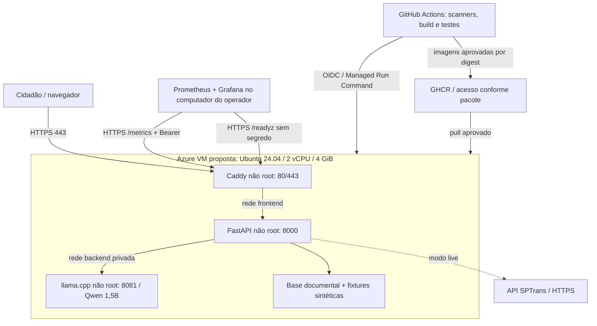

# Ficha Técnica - Ponto Certo / Deploy Blindado

| Campo | Definição |
|---|---|
| Produto | Ponto Certo, assistente de informação sobre ônibus municipais de São Paulo |
| Cidadão e problema | Pessoas que dependem do ônibus e precisam de informação confiável sobre linhas e espera |
| Proposta | Explicar informações com fontes, atualização e distinção entre ausência de informação, dúvida e falha |
| Disciplina | Secure DevOps Tools & Cloud Computing, Global Solution CitizenTech 2026.2, FIAP |
| Responsável IA e Cloud | Pedro Henrique Salvitti Habiro |
| Arquitetura | HTTPS/Caddy → FastAPI → recuperação documental e consultas controladas → Qwen local; SPTrans no modo live |
| Repositório | [Salvittis/ponto-certo](https://github.com/Salvittis/ponto-certo) |
| MVP público | Infraestrutura **PROVISIONADA**; aplicação e validação pública **PENDENTES**. [Hostname alocado](https://ponto-certo-fiap-rm88166.chilecentral.cloudapp.azure.com) |
| Dados | Demonstração sintética; integração real SPTrans depende de token e validação |
| Contribuição proposta | ODS 11, informação para mobilidade urbana; redução de espera não foi medida |

| Integrante | RM |
|---|---|
| Filipe Prado Menezes | RM98765 |
| Cássio Eid Kobaysahi Yonetsuka | RM99678 |
| Pedro Henrique Salvitti Habiro | RM88166 |

**Revisão documental:** 1.0.0, 19/11/2026. Nomes e RMs conferidos com a Ficha Técnica do [README](../README.md). Este documento explica a configuração; o [estado operacional](STATUS-CLOUD.md) e o manifesto de evidências registram o que foi realmente executado. A geração do PDF não realiza deploy nem transforma uma preparação em resultado validado.

## Escopo e leitura das evidências

Cloud publica a **mesma aplicação e o mesmo modelo** da frente IA. A API usa FastAPI. O modelo é Qwen2.5-1.5B-Instruct Q4_K_M, executado por llama.cpp b12464. A base documental, o protocolo de avaliação e os dados de demonstração permanecem os do repositório. Não há API comercial de LLM. Maker, RPA e visão computacional previstos pela equipe não são declarados como implementados nesta frente.

A infraestrutura usa Azure for Students, separada de qualquer conta corporativa. A ativação acadêmica foi confirmada pelo operador em 19/11/2026: US$100 de crédito, validade até 19/11/2027 e spending limit ativo. **Provisionamento CONCLUÍDO**: 12 recursos criados, nenhuma alteração/destruição, em `chilecentral` (Chile), com VM B2als_v2. Leitura posterior da API confirmou VM, NSG e IP em `Succeeded`; a [evidência sanitizada](../evidencias/cloud/terraform-applied.json) preserva configuração e limites. Hostname: [ponto-certo-fiap-rm88166.chilecentral.cloudapp.azure.com](https://ponto-certo-fiap-rm88166.chilecentral.cloudapp.azure.com). **A publicação e a validação pública da aplicação continuam pendentes**: hostname e VM não comprovam TLS ou inferência.

O PDF é compilado a partir desta configuração e de `evidencias/cloud/manifest.json`. Campos ausentes aparecem como **PENDENTE**. Evidência local não é renomeada como pública. Um print de workflow, um teste unitário de regra ou a existência de Terraform não comprovam, sozinhos, publicação, alerta real ou atendimento integral da rubrica.

## Arquitetura e limites de rede



A NSG permite somente TCP 80 e 443 de entrada; uma regra seguinte nega as demais portas, inclusive 22. A chave pública administrativa é requisito do recurso VM, sem abertura de SSH. Não há RDP, Docker socket ou porta do modelo expostos. App e LLM não publicam suas portas no host; Caddy atende as portas externas usando portas internas altas e usuário 10001. A rede backend é interna ao Compose. A app possui saída para fontes necessárias; não há controle restritivo de egress neste MVP.

Trata-se de uma VM única, sem alta disponibilidade nem balanceamento. Os 2 vCPUs são compartilhados entre host e containers; os limites individuais não reservam capacidade. B2als_v2 é burstable e pode reduzir desempenho quando os créditos de CPU acabarem. Medições do Mac com Metal não antecipam desempenho da VM x64 com CPU.

## Containerização e contrato IA

Os [Dockerfiles](../Dockerfile) e [modelo](../Dockerfile.llm) fixam bases por digest, executam como UID/GID 10001 e não copiam `.env`, state ou credenciais. O modelo GGUF tem revisão e SHA-256 verificados no build. Pesos ficam na imagem, evitando download após cada reinício. A tag de commit identifica a versão; o deploy usa o digest do conteúdo aprovado.

O [Compose local](../compose.yaml) publica apenas `127.0.0.1:8000`; o [Compose de produção](../compose.production.yaml) acrescenta Caddy/TLS. Os containers usam filesystem somente leitura, tmpfs limitado, `cap_drop: ALL`, `no-new-privileges`, limites de CPU/RAM e reinício `unless-stopped`. Produção: LLM até 3 GiB, app 512 MiB e proxy 128 MiB; a margem restante inclui sistema operacional e Docker e precisa ser medida. Certificados Caddy persistem em diretórios de propriedade do UID do proxy.

`/healthz` verifica processo e revisão; `/readyz` verifica prontidão essencial; `/metrics` exige Bearer. O healthcheck do processo não substitui teste real de inferência. O contrato completo está em [CONTRATO-IA-CLOUD.md](CONTRATO-IA-CLOUD.md). Perguntas de demonstração usam cenários sintéticos claramente identificados. Em falha real, a interface deve informar indisponibilidade, sem simular sucesso.

## Terraform, identidade e state

[infra/OPERACAO.md](../infra/OPERACAO.md) é a referência operacional detalhada. Terraform provisiona RG dedicado, VNet/subnet, NSG, NIC, IP Standard/DNS, VM Ubuntu 24.04 com imagem de versão numérica fixa, SSD 32 GiB e identidade de deploy. Provider AzureRM 5.14.0 e checksums estão fixados no lockfile. Cloud-init instala Docker/Compose pelo repositório oficial, prepara diretórios e rotação de logs; não contém segredos.

O state fica fora do checkout em `$HOME/.local/share/ponto-certo/terraform/terraform.tfstate`, via `bash infra/tf.sh`. Pasta 700, arquivos 600 por `umask 077`, backend com lock local e um único operador. FileVault foi verificado ativo; backup pós-apply em 600 foi comparado por SHA-256 com o state, no **mesmo disco FileVault**, fora do checkout. Não é backup offsite e não protege contra perda do computador. `sensitive` no Terraform **não cifra** state. `.tfvars`, planos, chaves privadas, cache e state não entram no Git nem em artefatos de Actions.

A identidade gerenciada de CI não é anexada à VM. Federação OIDC confia no repositório e environment `production`; a regra do environment deve permitir somente `main`, porque o subject com environment não inclui branch. RBAC dá leitura de VM/instanceView e read/write/delete de Managed Run Commands, atribuído apenas à VM. Não permite criar rede, VM ou permissões. Executar comando continua sendo poder administrativo sobre esse host.

`METRICS_TOKEN` e, no modo live, `SPTRANS_TOKEN` são enviados em `protectedParameters`, por JSON temporário 600. O script não imprime o payload. Na VM, `/opt/ponto-certo/runtime.env` é 600 e `/opt/ponto-certo` é 700. OIDC usa credencial curta, sem secret duradouro Azure. Para pull de pacotes GHCR privados, o fluxo de deploy usa `GITHUB_TOKEN` efêmero com `packages: read`, enviado como parâmetro protegido para login Docker temporário e removido ao final. Esse token não pertence ao arquivo de runtime. Não publicar tokens, `.env`, parâmetros protegidos ou state em capturas.

## Pipeline e bloqueio verificável

[devsecops.yml](../.github/workflows/devsecops.yml) executa em cada push, pull request e disparo manual. Os jobs verificam Gitleaks (histórico), Semgrep (política local), testes de regressão, build de app/LLM e Trivy nas imagens app, modelo e proxy. HIGH/CRITICAL e achados de segredo barram as imagens. Versões e ações estão fixadas; exceções futuras precisam de justificativa revisada.

Publicação depende de todos os gates. Em push na `main`, o job publica **os mesmos arquivos de imagem já examinados**, sem rebuild, resolve os digests de app, LLM e proxy e libera deploy. Não se presume que pacotes GHCR sejam públicos; o código-fonte público permite reprodução por build. O environment `production` autentica por OIDC; [deploy-azure.py](../scripts/deploy-azure.py) só aceita refs GHCR por digest e uma VM marcada como Ponto Certo. [release.sh](../deploy/release.sh) espera cloud-init, serializa releases, aplica Compose e tenta restaurar a configuração anterior se a operação ou validação pública falhar. Primeira instalação não possui versão anterior: a recuperação interrompe a release defeituosa. O job verifica HTTPS, revisão, prontidão e smoke com modelo real; o manifesto registra o resultado efetivo.

Para demonstrar o bloqueio, [security-demo.py](../scripts/security-demo.py) cria uma função sintética com `eval`, nunca importada ou executada. A sequência de evidência requer commit com achado, execução barrada e deploy ausente, correção e nova execução da **mesma política** aprovada. Gitleaks não deve receber segredo real para esse ensaio. Remover scanner, baixar severidade ou usar `continue-on-error` não é correção. Links de runs, commits e prints entram no manifesto; preparação do script não é prova de CI executado.

## Métricas, alerta e recuperação

[OBSERVABILIDADE.md](OBSERVABILIDADE.md) define a stack local Prometheus/Grafana, permitida pela rubrica p.53, coletando a mesma URL pública. Grafana e Prometheus escutam só em loopback; o modelo permanece privado. O computador do operador precisa estar ativo para a coleta continuar.

| Sinal | Definição e unidade | Limite de interpretação |
|---|---|---|
| Latência | p95 do histograma HTTP `/api/ask`, janela 5 min, segundos | Aproximação por buckets; não inferir zero sem amostras |
| Tráfego | `rate(ponto_certo_http_requests_total[5m])` filtrada por `/api/ask`, perguntas/s | Probes e arquivos estáticos ficam fora da jornada |
| Erros | Taxa HTTP 5xx / taxa total de perguntas, em % | `not_found` e `clarification` não são erros de infraestrutura |
| Saturação | `100 * ponto_certo_llm_inflight / ponto_certo_llm_capacity`, % | Ocupação do único slot; não equivale ao uso de CPU |

Coleta e avaliação a cada 15 s. As regras `PontoCertoPublicReadyUnavailable`, `PontoCertoModelNotReady` e `PontoCertoMetricsUnavailable` exigem condição por 1 min para reduzir ruído transitório; reservar cerca de 90 s para o ensaio. Prometheus registra `firing`; não foi configurado e-mail/WhatsApp. Retenção local: 10 dias ou 512 MB, o que vier primeiro.

Registrar operação saudável, interromper brevemente a LLM **do serviço monitorado**, aguardar disparo, preservar alvo/horário/JSON/print e restaurar a mesma versão. Confirmar `/readyz` 200, inferência e resolução. Se o ensaio escolhido for falha de autenticação da telemetria, identificá-lo assim: ele não prova queda da LLM. Série de teste unitário sintética, print vazio e serviço local não são alerta público real.

## Reprodução integrada

1. Clone o repositório e confira o contrato IA. Na raiz, `docker compose -f compose.yaml config --quiet` e `docker compose -f compose.yaml up -d --build`. Defina um token de métricas por ambiente/arquivo protegido, sem incluí-lo no comando publicado. Execute `python3 scripts/smoke.py --base-url http://127.0.0.1:8000 --expect-mode demo --output reports/smoke-local.json`.
2. Ative Azure for Students em conta acadêmica autorizada. Confirme crédito, spending limit, região, SKU, quota e permissão. Leia [pré-requisitos e comandos de infraestrutura](../infra/OPERACAO.md). Não usar assinatura corporativa nem converter para modalidade paga.
3. Execute `bash infra/tf.sh init` e `bash infra/tf.sh validate`. Preencha `.tfvars` externo com assinatura, chave pública, DNS, `chilecentral` e imagem numérica. Verifique a URN exata com `az vm image show --location chilecentral --urn Canonical:ubuntu-24_04-lts:server:24.04.202611170`, incluindo x64/Gen2/Trusted Launch; listagem por prefixo pode selecionar daily/Gen1. Faça plano externo, revise recursos/custo/rede e só então aplique. Guarde evidência sanitizada, sem state completo.
4. Configure environment `production` limitado à `main`, IDs Azure e tokens em Secrets, RG/VM/URL em Variables. O pipeline aprova e publica os digests de app/LLM/proxy; pacotes privados exigem acesso de leitura do job e token efêmero no pull. Para reproduzir sem acesso aos pacotes, faça build dos Dockerfiles a partir do código público. O deploy via Managed Run Command precisa ser concluído de verdade; existência do workflow não o habilita automaticamente.
5. Verifique TLS, `/healthz`, `/readyz`, pergunta documental e chegada demo, fontes, modo, revisão e reinício. Guarde o smoke público. Para live, provisionar token SPTrans e validar retornos reais antes de afirmar cobertura.
6. Configure `python3 observability/configure.py --url https://URL-REAL` e suba `docker compose -f compose.monitoring.yaml up -d`. Gere perguntas reais, registre os quatro valores na janela, realize alerta controlado com recuperação, capture dashboard e pipeline sem segredos.
7. Atualize o manifesto e gere/revise visualmente o PDF. A URL e o commit informados devem corresponder ao serviço que foi medido. O envio acadêmico é feito por Pedro/equipe.

## Responsabilidades, dados e LGPD

| Camada | Responsável operacional |
|---|---|
| Datacenter, hardware e virtualização | Microsoft, conforme serviço IaaS contratado |
| Conta, IAM, rede, SO, patches, Docker, aplicação, modelo e segredos | Equipe, com Pedro responsável por IA/Cloud |
| Dashboard, coleta, interpretação, restauração e evidências | Equipe/operador do computador de monitoramento |
| Validação acadêmica e envio | Pedro ou integrante designado; não automatizado por este repositório |

O aplicativo não exige cadastro, CPF, telefone, nome ou geolocalização. Não mantém histórico de conversas nem analytics. Perguntas podem conter dados pessoais inseridos voluntariamente: a interface orienta não enviá-los. Processamento transitório ainda é tratamento; ausência de banco não significa ausência de dados. Uvicorn e Caddy têm access logs desabilitados; métricas usam rótulos controlados sem pergunta, IP ou linha escolhida. Logs técnicos têm rotação, mas precisam de inspeção para garantir que dependências não acrescentem conteúdo sensível.

A VM foi alocada em `chilecentral`, no Chile, fora do Brasil, conforme apply e leitura da API. A aplicação ainda depende de deploy; metadados, serviços de controle e fornecedores podem ter outros fluxos. A seleção anterior de Brasil Sul foi descartada por restrições de SKU; não é residência efetiva. Antes de ampliar para uso real com dados pessoais, a equipe deve definir finalidade, base legal, aviso, canal de atendimento, retenção e mecanismo aplicável de transferência internacional, verificando contratos do provedor e orientação da ANPD. O desenho não é uma certificação de conformidade LGPD. Referências: [responsabilidade compartilhada Microsoft](https://learn.microsoft.com/azure/security/fundamentals/shared-responsibility) e [transferência internacional ANPD](https://www.gov.br/anpd/pt-br/assuntos/assuntos-internacionais/transferencia-internacional-de-dados).

## Crédito, capacidade e manutenção

Estimativa de [infra/OPERACAO.md](../infra/OPERACAO.md), preços Microsoft Retail API consultados em 19/11/2026, Linux `chilecentral`, 216 h (9 dias), com margem para manter o serviço até 27/11:

| Item | Referência | Consumo estimado de crédito |
|---|---:|---:|
| B2als_v2, 2 vCPU / 4 GiB | US$0,0526/h | US$11,3616 |
| Standard SSD E4 LRS, 32 GiB | US$3,36/mês | ~US$1,0080 |
| IPv4 Standard | US$0,005/h | US$1,0800 |
| Base | | **US$13,4496 (~US$13,45)** |

Disco proporcional usa mês de 30 dias. Operações SSD (US$0,0028/10 mil), saída de rede e duração maior podem alterar o total. Não é gasto realizado nem promessa de custo zero: a intenção é **R$0 desembolsado usando crédito educacional**. Students oferece US$100 por 12 meses, sem cartão, sujeito à verificação; crédito expirado/esgotado pode desabilitar o serviço. Não remover spending limit nem habilitar plano pago. O preflight confirmou SKU/quota e estimativa; somente o apply comprova alocação.

Manter aplicação, repositório e evidências acessíveis **até pelo menos 27/11/2026 às 23h55, America/Sao_Paulo**, e confirmar fim da correção antes de encerrar. Não há desligamento automático. Conferir saldo, expiração, disco, prontidão e créditos de CPU; manter coleta local ativa e registrar eventuais lacunas. Uma VM única pode ter interrupções e não fornece SLA definido pela equipe.

Depois da liberação do responsável, preservar evidências e backup cifrado, revisar plano de destroy e remover somente o RG acadêmico/recursos geridos. Parar a VM não elimina custo de disco/IP. Revogar credenciais e federação no encerramento. Nunca limpar recursos corporativos.

## Rubrica e critérios de aceitação

| Rubrica Cloud | Peso | Configuração verificável | Evidência de execução necessária |
|---|---:|---|---|
| Containers | 2 | Dockerfiles, Compose, não root, pesos fixados | Build, usuários efetivos, healthchecks, inferência real e restart |
| Terraform | 3 | HCL, lockfile, NSG, state protegido | Apply real, recursos, rede e state protegido sem conteúdo sensível |
| CI/CD seguro | 4 | Gitleaks, Semgrep, Trivy, build, gates | Run aprovado e run barrado, commits, deploy ausente no bloqueio, atualização real |
| Observabilidade | 3 | Quatro métricas, dashboard e regras | Valores reais, alvo público, janela, alerta firing e recuperação |
| Documentação | 2 | Ficha, arquitetura, reprodução, responsabilidades | PDF legível, links e evidências correspondentes à versão publicada |

O material oficial traz 10 pontos/Teams na regra geral p.24 e 14 pontos/portal na rubrica Cloud p.52-53. Essa divergência é registrada, sem inventar equivalência ou decisão institucional. O prazo publicado é **19/11/2026 às 23h55 de São Paulo**. Pedro/equipe devem confirmar o canal exigido e realizar a submissão. Preparação técnica, repositório e PDF não são comprovante de envio.

## Manifesto e geração do PDF

O script [build-cloud-pdf.py](../scripts/build-cloud-pdf.py) lê a ficha do README e campos permitidos do manifesto. Não faz chamadas de rede, Git, cloud ou coleta de segredos. Aceita uma evidência apenas se o caminho local existir dentro do repositório ou houver link HTTP(S) sem credenciais/query. A presença de arquivo não verifica seu conteúdo: revisão humana/visual permanece necessária. Para apresentar um check como validado, exige `status: passed`, `scope`, `checked_at` e ao menos referência existente ou URL. Sem esses elementos, registra PENDENTE.

Esquema mínimo extensível (valores abaixo são marcadores de estrutura, não evidência):

```json
{
  "schema_version": 1,
  "updated_at": "DATA-ISO-DA-COLETA",
  "revision": "SHA-COMPLETO-DO-COMMIT",
  "repository_url": "https://github.com/Salvittis/ponto-certo",
  "public_url": "",
  "provisioning": {
    "status": "pending", "scope": "public", "checked_at": "",
    "region": "", "vm_size": "", "summary": "Conclusão do apply pendente",
    "evidence": []
  },
  "checks": {
    "docker": {
      "status": "pending", "scope": "local", "checked_at": "",
      "summary": "", "commit": "", "url": "", "evidence": []
    }
  },
  "metrics": {
    "scope": "", "target": "", "window": "",
    "latency_p95_seconds": null,
    "traffic_requests_per_second": null,
    "error_rate_percent": null,
    "saturation_percent": null
  },
  "screenshots": {
    "dashboard": {"path": "evidencias/cloud/dashboard.png", "scope": "", "caption": ""}
  }
}
```

Checks suportados: `docker`, `terraform`, `ci_pass`, `ci_block`, `public_app`, `restart`, `metrics`, `alert`, `recovery`. Estados: `passed`, `failed`, `partial`, `pending`, `in_progress`. Escopos: `local`, `public`, `configuration`. Screenshots: `pipeline_pass`, `pipeline_block`, `dashboard`, `alert`, `recovery`; cada um contém path, scope e caption. O gerador usa só imagens existentes, sem reservar espaços vazios. Capturas `evidencias/interface*.jpg`, quando presentes, são sempre legendadas como **IA real local / dados demo**, sem serem promovidas a prova de nuvem. O objeto opcional `costs` atualiza a estimativa com `region`, `checked_at`, `hours`, `vm_hourly_usd`, `ip_hourly_usd`, `disk_monthly_usd` e `total_estimate_usd`; valores ausentes continuam PENDENTE e não herdam preços de outra região.

```sh
python3 scripts/build-cloud-pdf.py --check
python3 scripts/build-cloud-pdf.py
```

Requer ReportLab e Pillow. No ambiente Codex, usar `/Users/salvitti/.cache/codex-runtimes/codex-primary-runtime/dependencies/python/bin/python3`. Saída única: `output/pdf/Ponto-Certo-Deploy-Blindado.pdf`. Reexecutar substitui esse PDF usando as evidências atuais. O processo gera 12 seções paginadas e links clicáveis; revisar quantidade de páginas, renderização e legibilidade após cada geração. Antes de enviar, conferir que documento/manifesto/URL e commit correspondem à mesma entrega.

## Fontes oficiais e documentos de referência

- [Azure for Students](https://learn.microsoft.com/azure/education-hub/about-azure-for-students), [limite de gastos](https://learn.microsoft.com/azure/cost-management-billing/manage/spending-limit) e [crédito expirado/esgotado](https://learn.microsoft.com/azure/cost-management-billing/manage/azurestudents-subscription-disabled).
- [B2als_v2 e CPU credits](https://learn.microsoft.com/azure/virtual-machines/sizes/general-purpose/basv2-series), [Retail Prices API](https://learn.microsoft.com/rest/api/cost-management/retail-prices/azure-retail-prices) e [IP público/DNS](https://learn.microsoft.com/azure/virtual-network/ip-services/public-ip-addresses).
- [Managed Run Command](https://learn.microsoft.com/azure/virtual-machines/linux/run-command-managed), [OIDC Azure/GitHub](https://learn.microsoft.com/azure/developer/github/connect-from-azure-openid-connect) e [permissões Compute](https://learn.microsoft.com/azure/role-based-access-control/permissions/compute).
- [Provider AzureRM 5.14.0](https://registry.terraform.io/providers/hashicorp/azurerm/5.14.0), [state sensível](https://developer.hashicorp.com/terraform/language/manage-sensitive-data) e [backend local](https://developer.hashicorp.com/terraform/language/backend/local).
- [Docker no Ubuntu](https://docs.docker.com/engine/install/ubuntu/), [Prometheus alert rules](https://prometheus.io/docs/prometheus/latest/configuration/alerting_rules/) e [Grafana provisioning](https://grafana.com/docs/grafana/latest/administration/provisioning/).
- [Modelo Qwen e licença](https://huggingface.co/Qwen/Qwen2.5-1.5B-Instruct-GGUF), [llama.cpp b12464](https://github.com/ggml-org/llama.cpp/releases/tag/b12464), [SPTrans desenvolvedores](https://www.sptrans.com.br/desenvolvedores) e [documentação Olho Vivo](https://www.sptrans.com.br/desenvolvedores/api-do-olho-vivo-guia-de-referencia/documentacao-api).
- PDF oficial da disciplina: `Desafio-FIAP-GS-CitizenTech 4ES.pdf`, p.18-25 (orientações/Ficha), p.28-31 (IA), p.51-53 (Cloud), preservado na pasta FIAP.
